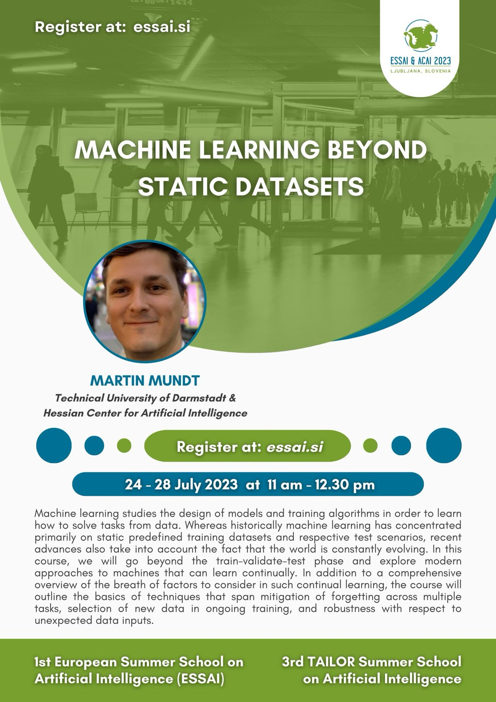

We are excited to present a 5-day course on "Machine Learning Beyond Static Datasets" as part of the European Summer School on AI (ESSAI) in Ljubljana, Slovenia from July 24-28. Join the course to learn how to transcend the traditional static train-test machine learning focus and move all the way to the central elements underlying lifelong learning.

The description and schedule for a plethora of interesting other courses, together with the ESSAI registration, can be found on the website: [https://essai.si](https://essai.si)

