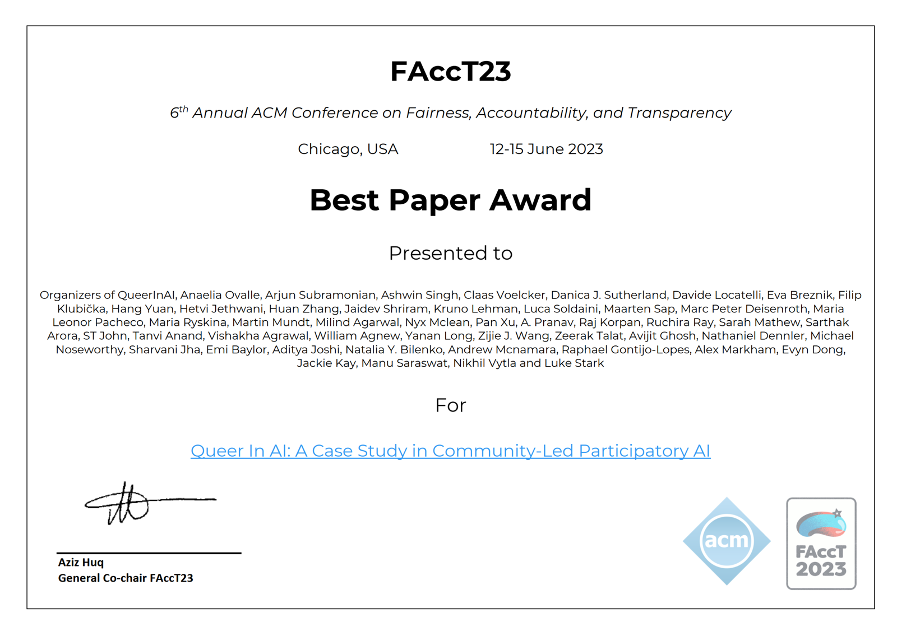

The recently accepted Queer in AI paper titled "[Queer in AI: A case Study in Community-led Participatory AI](https://dl.acm.org/doi/10.1145/3593013.3594134)" has received the **best paper award **at the ACM Conference on Fairness, Accountability, and Transparency (ACM FAccT) 2023.

