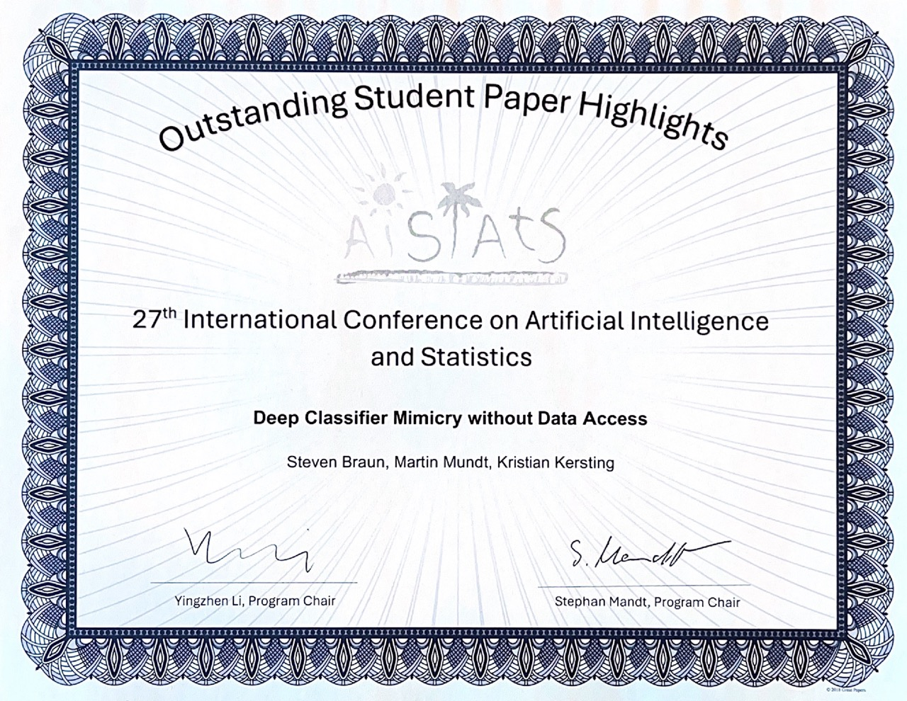

We are very honored and grateful that our paper “_Deep Classifier Mimicry without Data Access_” has received an **Outstanding Student Paper Highlight** award at AISTATS 2024.

In the paper, we introduce a method to distill a deep classifiers knowledge without making assumptions on model structure and without requiring access to original data. You can read the full paper at [this link](https://proceedings.mlr.press/v238/braun24b/braun24b.pdf).

