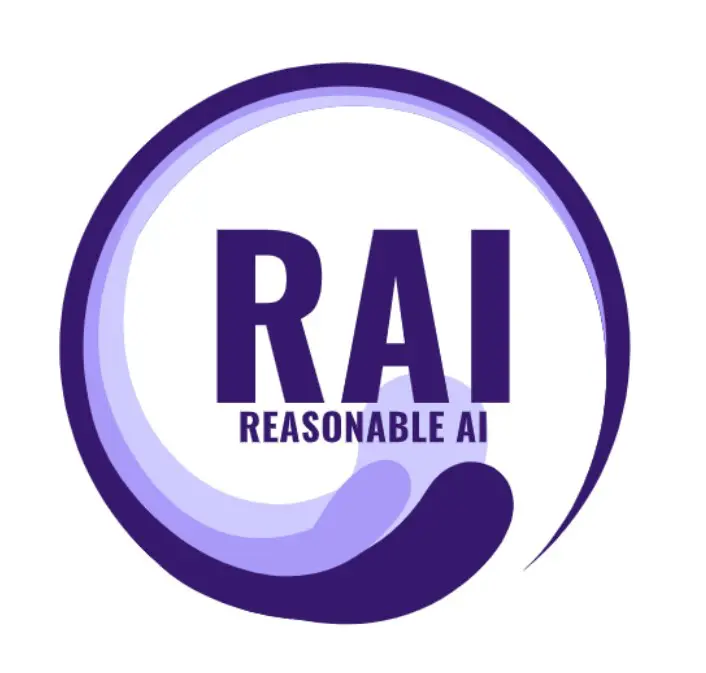
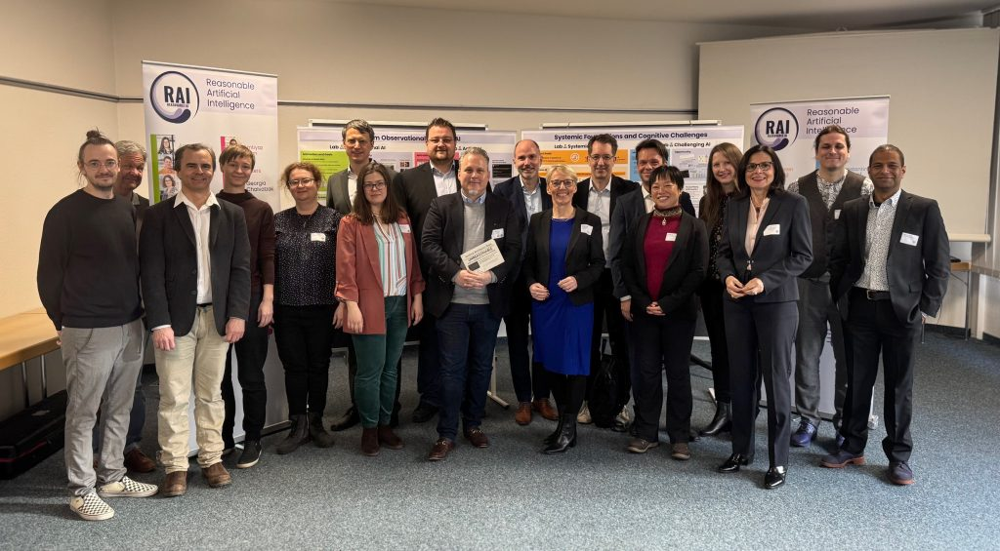

We are very happy and proud to be part of the team within the newly funded cluster of excellence "RAI: Reasonable Artificial Intelligence"!

RAI has succeeded in a prestigious and highly competitive process through the Excellence Strategy of the German federal and state governments. The cluster is headed by TU Darmstadt as the lead institution with research principal investigators at participating institutions: Julius Maximilian University Würzburg, Goethe University Frankfurt am Main, the University of Tübingen, the University of Saarland and the University of Bremen (the latter through our lab).

As implied by the name, the primary goal of RAI is to research a new generation of AI systems that learn in "reasonable" ways. In this context, "reasonable" refers not only to the current inability of AI systems to reason properly and employ common sense, but also their present unreasonable resource inefficiency, their inability to adapt adequately, as well as required improvements to become more reasonable in terms of socio-ethical outcomes. To this end, the RAI cluster focuses on advancing four pillars: Systemic AI, Observational AI, Active AI, and Challenging AI.

- Systemic AI: This area focuses on the development of software and system methods that will enable RAI systems to be trained efficiently and support their integration into existing systems.
- Observational AI: This research area focuses on contextual learning and brings together different AI concepts to provide RAI with a good level of common sense.
- Active AI: This area focuses on continual and adaptive lifelong learning with active exploration so that RAI systems are able to adapt better.
- Challenging AI: This research area develops measurement and evaluation methods (benchmarks) that can be used to evaluate and improve the performance of RAI systems.

We are very proud to be part of this excellence cluster and look forward to intense 7 years of innovative research to drive the next generation of AI. [Find out more about RAI](https://www.hessian.ai/projects/reasonable-ai-rai/).

